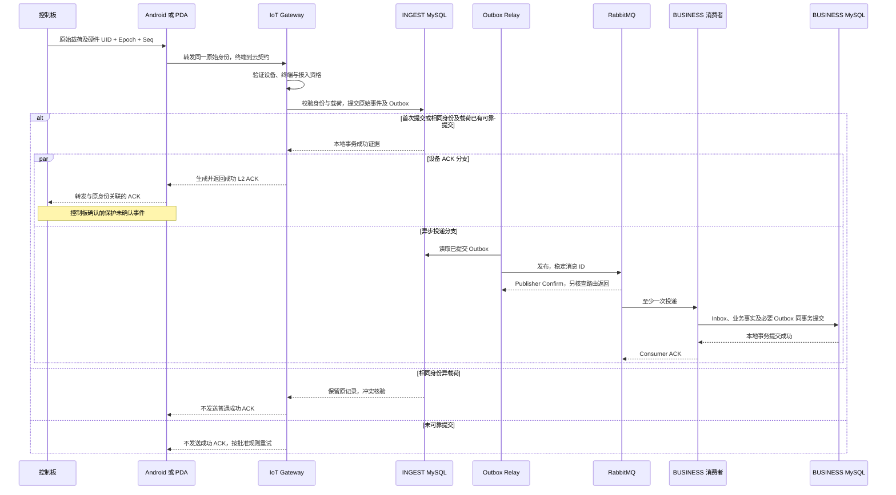

# 跨 ADR、模块及端到端依赖审核

基线 `1ae32653e15518879e74cd1f038b7635b2e977b8`。下列关系用于架构评审及设计排期。ADR 交叉引用能够互为背景，Maven 依赖必须单向。稿件、模块责任与数据归属仍为候选。依据 [C-06](../standards/module-boundaries.md)及[已有映射方案](../../engineering/module-mapping.md)。

## 领域约束矩阵

| 审核链 | 关联 ADR | 结论及约束 |
| --- | --- | --- |
| 架构及交付 | 001、002、006、034、038、040 | 有条件通过。OpenJDK 21 构建和运行与 Java 17 编译分开；Maven 3.9.12、Spring Boot 3.5.16、MySQL 8.4。模块化单体及独立 Gateway。Docker 生产候选、k3s 开发测试候选、Jenkins CI/CD 候选。Kafka、Nacos、Elasticsearch、Kubernetes 无 P0 强制要求。GAP-001 |
| 租户、组织及项目 | 003～005、017、018、025、026、030～032、036 | 有条件通过。共享应用/数据库的行级约束、政府显式跨项目授权和有效期、企业及设施各自授权；产废主体无默认租户身份。统一核查缓存、地图、统计、导出、附件及消息、线程、定时任务的可信上下文和清理，默认拒绝；超级管理员和 TenantIgnore 不授予政府监管范围。DEC-008、GAP-002～004 |
| 硬件、协议及终端 | 013～017、027、033、036～040 | 待确认。硬件设计输入（待硬件验证）为 STM32G0B1RET6、12–36 V、四路 HX711、500/800 kg 传感器、五线（激励正负、信号正负和屏蔽）、三路数字输入、三个 ISO15693 读卡器、RS485、BLE/经典蓝牙、GNSS。协议候选为 12 字节硬件 UID、8 字节 RFID UID、AA55、CRC16、小端、115200 8N1、Epoch 毫秒、有符号 INT32 克、硬件 UID + Epoch + Seq、16 MiB 环形存储。禁止远程液压举升或倾倒。CRC 参数、帧、鉴权、回收和升级详见 DEC-001～004 |
| 定位和地图 | 009～011、014、019、020、025、026 | 有条件通过。记录原始坐标系和来源，区分 WGS84、CGCS2000、GCJ02、BD09 及投影坐标，转换记录版本和用途；控制板 GNSS 优先，按当前 Android/PDA 形态回退。以有效事件时点匹配称重位置，迟到轨迹不得覆盖最新有效位置或历史事实。围栏、路线偏离和交付各自判断。核查漂移、权限、限行、供应商许可与降级，乘用车路线无法验证货车合规。DEC-009/010 |
| RFID、归属及计量 | 003～005、015～018、021、024、030、033 | 有条件通过。先确认卸桶方向、清旧缓存、开新读卡窗口，按读卡器与作业/桶映射保留 UID 原始字节。一主体多标签，按可信事件时间匹配历史标签和安装关系，时间异常转核验。未知、未绑定、停用和冲突保留事件，无默认商户及自动计费，人工归属须授权审计。P0 无强制垃圾桶资产管理。DEC-005/007 |
| 正式称重与作业 | 015～023、027 | 有条件通过。原始事件→作业称重及必要桶明细→审核/正式记录→计费依据。作业可产生多个候选对象，唯一键及父子关系待批。660L 单桶、240L 双桶各有粒度，缺独立证据不可均分或双计。路线模板版本→计划→任务/站点→车辆与人员下发/接收→执行→批次/交付。任务、终端接收、在线、称重、交付、计费各有状态。处理未匹配、临时、取消后迟到、异常、校准版本及已计费调整，原始事实不可改。DEC-005/011 |
| 设施及交付 | 011、015、021～024、028 | 有条件通过。P0 人工地磅录入入场毛重和出场皮重，算交付净重并核验；批次关联正式称重，支持一任务多交付，合并/拆分待定，修正保留历史及凭证附件。设施/车载计量分别核对，禁止按比例改商户称重，车载精度目标无法直接当作交付差异阈值。DEC-011/012 |
| 合同、计费及财税 | 015、016、018、021、023、024、025、028、030、032、036、037 | 待确认。收费主体、服务项目、有效合同/政府规则、审核重量、计费重量、计费依据、明细、账单、发票、支付结算和可审计调整分开。精确十进制按重量、单价、金额和税额分别定精度。P0 全电发票和 P1 在线支付为候选。DEC-012/013 包含规则优先级、交付、税费、红冲、回调与查询对账。 |
| 统计与专题图 | 015、020、021、023～026、035、036 | 有条件通过。ADR-025 的 22 项仍为候选。口径以版本化指标字典登记来源、粒度、时间、重量、去重、过滤、授权、重算及地图/报表一致性。原始消息量、正式记录量、收运量、垃圾产生量分别核算。未知归属重量可留在适用车辆/批次汇总，勿分摊给商户。DEC-014 |
| 安全、合规与监控 | 003、005、027～034、036～040 | 有条件通过。用户、终端、设备、外部系统与服务身份分离；UID 仅标识，CRC16 仅差错检测。逐设备凭据、历史补传认证、轮换/撤销、附件授权、审计可靠性、日志脱敏、备份加密和 AI 最小可见均须专项验收。等保三级为建设目标，180 天为候选审计基线，信创仅按产品及版本核验。DEC-002/008/015/018、VAL-006 |
| 容量与恢复 | 012、024、028、032、035～039 | 有条件通过。发布、接收及最终业务各有观测水位与恢复点。具体负载与拓扑留待 DEC-016，故障域与承诺受 BLOCK-007 约束。 |

## 模块职责、数据归属和依赖

箭头从调用方指向可依赖契约，事件消费者可以订阅生产者拥有的契约。事件信封归 event-api，业务事件语义由其领域所有者维护。

| 逻辑模块 | Maven 候选 | 候选职责及数据 | 允许方向或接口 |
| --- | --- | --- | --- |
| sanitation-common | 基础 JAR | 公用值类型与技术原语，无领域数据 | 无业务依赖 |
| sanitation-base | API + Biz | BUSINESS 主体、项目、基础档案、服务点、设施档案；RFID 及资产与设备共享职责待定 | common，必要的上游 System/Infra 公开能力 |
| sanitation-gis | API + Biz | TRACK 正式轨迹、位置读模型；BUSINESS 的边界/地理主数据协调待定 | common、base-api，发布轨迹与位置事件 |
| sanitation-device | API + Biz | 接入事件契约、设备与安装历史、原始 INGEST 事实；物理写入责任由 DEC-006/011 确认 | common、base-api，适配 IoT Core。Gateway 经公开接入契约 |
| sanitation-operation | API + Biz | BUSINESS 计划、任务、正式称重、审核、批次、交付及生产者 Outbox | base-api、gis-api、device-api，经业务事件发布完成事实 |
| sanitation-billing | API + Biz | BUSINESS 合同、计费、财务状态及其业务 Outbox | operation-api、base-api，开票经事件与通用适配交互 |
| sanitation-analysis | Biz，有同步消费者时提取 API | 统计读模型、指标版本与导出；独立投影，库归属待定 | 生产者的版本化事件及必要读契约，专题数据由上层组装 |
| sanitation-event | API + Biz | Outbox/Inbox 技术能力、告警契约候选；每个本地事务的记录留在所属逻辑库。业务告警所有权待定 | common、公开事件信封，Biz 无领域回调 |
| sanitation-integration | Biz，复用契约时再提取 API | BUSINESS 外部业务映射、请求及回调状态、对账与交付接口，有关凭证由领域持有 | 所需领域 API、event-api；GIS 与设备协议职责留在对应边界 |

Gateway 独立可执行，依赖 IoT Core、接入契约与基础设施，不依赖 sanitation Biz、跨进程 BUSINESS 写入或计费。INGEST 只存原始事件及接入证据，BUSINESS 存业务事实及 Inbox/Outbox，TRACK 独立幂等提交。禁止跨逻辑库原子事务和外键，禁止跨模块 Mapper、DO、Biz 或私表访问，禁止无条件拆成九个微服务。operation↔billing、operation↔device 用事件或读模型切断；base↔gis 由上层组装；event↔领域 Biz 以事件信封和技术端口切断；领域↔analysis/integration 保持契约单向，不回调下游 Biz。统计跨域读口径、专题图层、RFID 绑定、告警和设施资料所有权列入 DEC-011/014。

## 端到端候选时序

Android 经 RS485、PDA 经蓝牙分别与控制板构成完整部署模式，不要求两类终端同时存在，也不假定控制板直连云。终端转发保持原身份，云协议及终端/用户/设备鉴权分开。C-04 的成功确认表明鉴权且符合接入条件的事件已可靠提交。

相同身份同载荷重试可重发既有确认，且不新增 Outbox。Relay 分支代表已提交 Outbox 的独立进度，包括在本次重传之前已投递的情况。终端本地缓存、Gateway 内存/SQLite、Redis、Publisher Confirm 和正式称重结果都无法替代 INGEST 证据。设备事件身份和消息 ID 分开，一个业务事件可派生多个消息，生产者定义各消息身份契约。

## 故障窗口

20 种场景均为候选设计检查，测试尚待执行。验证应使用各阶段唯一账本与审计证据，避免按不同状态总数直接推算丢失。

| # | 故障 | 处理原则 | 专项证据及归属 |
| --- | --- | --- | --- |
| 1 | 控制板生成后断电 | 恢复持久未确认记录与原身份；断电写入窗口单测并显式报错 | 实机掉电与日志，DEC-004 |
| 2 | 终端收到后断电 | 恢复转发，板未确认继续保存；终端本地保存只作恢复 | 两终端各自冷启动，DEC-004 |
| 3 | Gateway 收到后退出 | 查询可靠提交或由设备重传，无提前确认 | 进程边界，BLOCK-002/003 |
| 4 | INGEST 提交前失败 | 原始事件与 Outbox 同时回滚，不成功 ACK | 事务检查，VAL-003 |
| 5 | INGEST 提交后 ACK 丢失 | 以同身份、同载荷重传并复用已提交结果 | 一条原始和一条 Outbox，BLOCK-003 |
| 6 | 终端已收、控制板未收 | 重发可靠确认或由板保持身份重传，终端确认不释放板事件 | 串口、蓝牙断连，DEC-003 |
| 7 | 重复补传 | 原始事件和 Outbox 不重复，业务消费也幂等 | 并发重传与多终端切换，VAL-003 |
| 8 | 相同身份、不同载荷 | 隔离取证，不覆盖或普通成功 ACK | 并发冲突与审计，DEC-002 |
| 9 | Outbox 发布前退出 | 扫描可重获待发项，稳定消息 ID | Relay 重启，VAL-003 |
| 10 | Publisher Confirm 丢失 | 按不确定发布处理，保留记录并有界重试，接收方去重 | Broker 与数据库对照，VAL-003 |
| 11 | 路由失败 | 明确不可达，保留待处理记录/告警，修复后受控重放 | mandatory/returned，VAL-003 |
| 12 | 确认后更新 Outbox 失败 | 稳定 ID 重发，Inbox 防重复副作用 | 人工检查状态与修复，VAL-003 |
| 13 | BUSINESS 提交前失败 | Inbox 与业务共同回滚，无消费确认，依策略重投或隔离 | 事务故障，VAL-003 |
| 14 | BUSINESS 提交后 Consumer ACK 丢失 | 已提交 Inbox 去重，按正确语义重新确认 | 消费断连、单次副作用，VAL-003 |
| 15 | Redis 不可用 | 普通缓存回源，授权失败关闭，数据库幂等继续承担最终正确性 | 鉴权及限流降级，GAP-002/003 |
| 16 | RabbitMQ 不可用 | 保留待发，限流和告警，INGEST 已提交可独立确认；关注容量/backpressure | Broker 恢复及积压，BLOCK-001/003 |
| 17 | 设备离线空间满 | 标记、告警并按批准策略停收/降级，保护未确认事件 | 真机闪存及换板，DEC-004 |
| 18 | 数据库主节点故障 | 明确已提交证据边界，在故障域内验证复制及切换，重试不改身份 | 写入口、复制、旧主隔离，BLOCK-007 |
| 19 | 跨库恢复点不同 | 隔离写入，对账原始/Outbox/Inbox/正式数据及 TRACK 后受控重放 | 时间点恢复，BLOCK-007 |
| 20 | 第三方成功、本地状态未更新 | 用稳定请求 ID 查询状态并对账，外部结果未知时避免盲目重试财务副作用 | 第三方沙箱及审计，BLOCK-006 |

开票、财税、监管及应用告警使用各自业务状态。发布确认成功并不证明消费或外部业务完成。所有补偿和人工重放保留原业务关联和证据。

## 22 项候选报表口径核对

每项以租户、显式授权项目、可核验来源和口径版本过滤。导出、地图和下钻应使用相同授权。下列用来定位必须确认的口径，最终字段、纳入状态、重算条件及历史版本属于 DEC-014。

| ADR-025 序号 | 指标及来源 | 粒度、时间、去重及终态核对 |
| --- | --- | --- |
| 01 | 垃圾产生责任主体；Base 主体 | 有效主体/项目按报表时点快照，跨项目汇总是否去重待定 |
| 02 | 服务点及服务覆盖；Base 服务关系 | 有效服务点/项目与覆盖分母分别计数，设施共享不重复 |
| 03 | 项目基础运营；Base 项目与 Operation 正式事实 | 项目与期间，计划、执行及完成分开展示 |
| 04 | 垃圾收运重量日报；正式称重 | 项目/业务日，正式收运净重，父子取一次，迟到与修正可重算 |
| 05 | 垃圾收运重量月报；正式称重 | 项目/业务月，沿用日报计量粒度及同版本重算，非账单重量 |
| 06 | 按垃圾类别收运重量；正式称重/字典 | 类别版本/期间，明确未知类别，仅一次有效计量 |
| 07 | 按行政区域收运重量；正式称重/GIS | 历史区域/期间，定义空间关系的版本和边界，多区汇总防重 |
| 08 | 按责任主体收运重量；正式称重/RFID 归属 | 历史可信主体/期间；无归属重量不摊销，正式审核修订留痕 |
| 09 | 按服务点收运重量；正式称重/服务点 | 历史关联服务点/期间，同一源重不重复计入共享服务点 |
| 10 | 车辆收运量；正式称重/历史安装 | 车辆/作业期间；组合重量可进适用车辆汇总，过滤重复 |
| 11 | 清运线路执行；版本化线路/任务与 TRACK | 线路版本/任务批次，计划与实际分开，异常与缺轨迹显式标记 |
| 12 | 作业任务完成情况；任务状态 | 任务/业务期间，冻结分母和终态窗口，取消与异常分列 |
| 13 | 站点服务完成；任务站点 | 任务站点/期间，正式服务完成条件，围栏或 RFID 单独不足 |
| 14 | 车辆里程及作业时长；TRACK/执行状态 | 车辆/有效定位时段，处理断点、迟到、漂移、重算和重复轨迹 |
| 15 | 批次交付；Operation 批次/交付 | 批次及交付次数各自统计，拆并和一任务多交付防重 |
| 16 | 设施接收重量；审核交付/设施 | 设施/接收期间，明确地磅与审核净重，从有效交付汇总 |
| 17 | 收运与交付重量差异；正式收运和交付 | 同批次、同类别和对齐范围，阈值另批，不按比例改原始值 |
| 18 | 称重及 RFID 异常；接入证据和审核 | 原始身份与异常类型分别计数，按发生和处置时点区分 |
| 19 | 设备运行及故障；生命周期/监控事件 | 设备/窗口，在线率分母、心跳和故障合并规则待定 |
| 20 | 告警与异常处理；Event/业务处理状态 | 告警实例/规则版本，触发、恢复、关闭状态分别计数 |
| 21 | 处理费和账单；Billing 计费明细/账单 | 计费期间/主体，区分重量与金额、有效规则及可审计调整 |
| 22 | 发票及费用结算；Billing 和集成结果 | 账单/发票/支付各自粒度，去重回调，单列红冲及未启用状态 |
