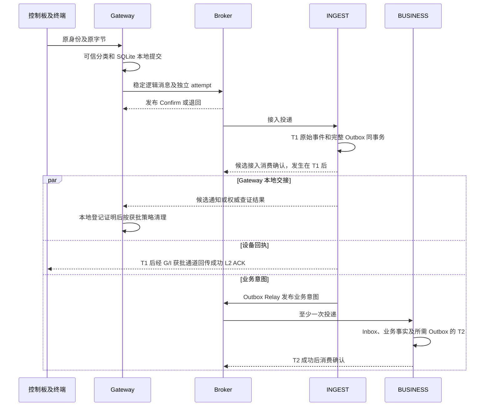

# ENG-002F-02B-2A 关键计量事件可靠交接详细设计

## 1. 基线和范围

仓库 `weeleng/car_weight`，基线 `master-jdk17` 的实际起始 SHA 为 `4f414b21ea64f770e5a5172d592c3ce81d9ee0a9`。新分支 `engineering/eng-002f-handoff` 从该提交创建。PR #20 两个父提交分别为 `ff2182d4fe628899f00d122071accd6b02451348` 与 `476bfaabf4729e8f629efe971416a015e909d1c3`。`git merge-base --is-ancestor` 确认 F-02B-1R 为祖先，`git diff --exit-code 476bfaabf..HEAD` 确认合并树与其交付树一致。执行了 `git status --short -b`、`git ls-remote`、`git fetch --no-tags origin refs/heads/master-jdk17:refs/remotes/origin/master-jdk17` 和 `git show -s`。工作区已有未跟踪环境报告保留。

PR #20 合并后 `Java CI with Maven` run `45961630079` 对应上述完整 SHA，首查为 In progress，复查为 **Success**，job `140380555192`。使用 `gh run list --commit <SHA>` 的 API 查询返回 Forbidden，之后从 GitHub 工作流列表和运行页面核对。工作流运行 `mvn -B -ntp -C package --file pom.xml -Dmaven.test.skip=true`，结论仅覆盖默认构建。[Actions 运行](https://github.com/weeleng/car_weight/actions/runs/45961630079) · [Maven 工作流](../../.github/workflows/maven.yml)

业务和技术依据为 [AGENTS](../../AGENTS.md)、[架构目录](../architecture/README.md)、[C-02 时间](../architecture/standards/time-conventions.md)、[C-03 重量](../architecture/standards/weight-conventions.md)、[C-04 ACK](../architecture/standards/iot-ack-and-durability.md)、[C-05 事务](../architecture/standards/transaction-boundaries.md)、[C-06 模块](../architecture/standards/module-boundaries.md)、[实施入口](../architecture/reviews/implementation-entry-gates.md)、[审批包](../architecture/reviews/decision-approval-packets.md)、[开放决策](../architecture/reviews/open-decision-register.md)、[生产门槛](../architecture/reviews/production-gate-approval-matrix.md)与[实施差距](../architecture/reviews/implementation-gap-register.md)。

按索引读取 [ADR-012](../../docs/architecture/adr/ADR-012-iot-ingestion.md)、[ADR-013](../../docs/architecture/adr/ADR-013-vwcp-protocol.md)、[ADR-027](../../docs/architecture/adr/ADR-027-mobile-and-vehicle-terminals.md)、[ADR-036](../../docs/architecture/adr/ADR-036-cache-and-asynchronous-processing.md)、[ADR-037](../../docs/architecture/adr/ADR-037-high-availability-and-disaster-recovery.md)。五份均为 Proposed。DEC-001～004、006、016 均为开放的 P0-DESIGN。其定版范围分别是协议、身份与认证、ACK、离线容量、三库及可靠消息、容量拓扑及故障域。BLOCK-001、002、003、007 均开放，分别需验收暂存及真实部署、设备安全与 ACK、可靠事务闭环、故障域及 HA。审批角色及范围以登记册为准。

前置证据来自 [E 设计](ENG-002E-reliable-messaging-design.md)、[E 隔离验收](ENG-002E-reliable-messaging-validation-report.md)、[F-01 设计](ENG-002F-gateway-spool-remediation-design.md)、[F-02A 验证](ENG-002F-gateway-spool-validation-report.md)、[F-02B-1/1R 实施报告](ENG-002F-gateway-spool-remediation-report.md)。E 的单意图及 F-02A 的合成 SQLite T1 证据用于推导验收断言。两者均无正式运行装配。本轮只新增此候选设计，人审批准接口与工作包前保持实现及生产门槛开放。

## 2. 合并后正式源码审计

| 位置 | 实际入口、状态和边界 | 关键事件差距 |
| --- | --- | --- |
| Gateway 消息服务 | `sendDeviceMessage` 从可信设备记录填入 device/tenant/server，调用 `generateMessageId`，取 Gateway 接收时间，缺少 requestId 时使用该消息 ID。普通入口清空不可信 raw，透传走独立校验及脚本路径。补传保存原 JSON 中的 Gateway ID。[Gateway 消息服务](../../yudao-module-iot/yudao-module-iot-gateway/src/main/java/cn/iocoder/yudao/module/iot/gateway/service/device/message/IotDeviceMessageServiceImpl.java) · [IotDeviceMessageUtils](../../yudao-module-iot/yudao-module-iot-core/src/main/java/cn/iocoder/yudao/module/iot/core/util/IotDeviceMessageUtils.java) | 重传重新进网关可重新生成 ID。现有 ID、设备库主键、requestId 和 spoolTime 均无法建立正式设备事件去重 |
| S1 选择与直发 | `isSpoolableMessage` 看启用、协议非空、属性/事件/批量 method 和非回执。无积压时调用 `sendDeviceMessageConfirmed`。配置默认 Redis、暂存关闭，Local 显式开启失败。[IotDeviceMessageSpoolServiceImpl](../../yudao-module-iot/yudao-module-iot-gateway/src/main/java/cn/iocoder/yudao/module/iot/gateway/service/device/spool/IotDeviceMessageSpoolServiceImpl.java) · [IotGatewayProperties](../../yudao-module-iot/yudao-module-iot-gateway/src/main/java/cn/iocoder/yudao/module/iot/gateway/config/IotGatewayProperties.java) · [Gateway 配置](../../yudao-module-iot/yudao-module-iot-gateway/src/main/resources/application.yaml) | method 无法表达计量关键性。直发开始与首次落盘之间存在故障窗口 |
| S1 回退与容量 | `append` 只在直发失败或已有积压时保存 JSON，SQLite 单连接、WAL + FULL。按 UTF-8 JSON 字节累计。满额、停止和写失败拒绝，永久拒绝直发不落盘。默认 2 GB、7 天、200 条/秒。[IotDeviceMessageSpoolServiceImpl](../../yudao-module-iot/yudao-module-iot-gateway/src/main/java/cn/iocoder/yudao/module/iot/gateway/service/device/spool/IotDeviceMessageSpoolServiceImpl.java) | 本地提交无 T1 含义，带宽、逻辑字节和磁盘空间分别治理 |
| S1 补传与删除 | `drain` 按自增 id 取批，确认或按旧策略跳过后推进删除前缀。未知/暂时失败停止本批并保留失败行与尾部。坏 JSON、缺 spoolTime、超期、永久拒绝按普通策略跳过，`expireIfNecessary` 另按 spool_time 清理。Confirm 和 SQLite 删除为分离操作，崩溃可重投。[IotDeviceMessageSpoolServiceImpl](../../yudao-module-iot/yudao-module-iot-gateway/src/main/java/cn/iocoder/yudao/module/iot/gateway/service/device/spool/IotDeviceMessageSpoolServiceImpl.java) | 关键事件须独立保全。确认后删除缺少 T1 证据。旧 JSON 内容和时间不足以授权丢弃 |
| 所有权、启动、关闭 | S2 退出扫描。S1 通过 `SpoolFileOwnership.acquire/verify` 做路径、inode、JVM 登记及 OS 锁，再持有 SQLite 原生独占连接。`SpoolStartupValidator.validate` 校验 v0、quick_check、表、列、索引和 WAL。现有表为 `iot_device_message_spool(id,spool_time,size,message)`。未知、不兼容、损坏及不可写启动失败。`destroy` 停收，待 `drainStopped` 与 `activeDirectSends=0` 才关库释放，补传等待五秒可先返回。[SpoolFileOwnership](../../yudao-module-iot/yudao-module-iot-gateway/src/main/java/cn/iocoder/yudao/module/iot/gateway/service/device/spool/SpoolFileOwnership.java) · [SpoolStartupValidator](../../yudao-module-iot/yudao-module-iot-gateway/src/main/java/cn/iocoder/yudao/module/iot/gateway/service/device/spool/SpoolStartupValidator.java) · [IotDeviceMessageSpoolServiceImpl](../../yudao-module-iot/yudao-module-iot-gateway/src/main/java/cn/iocoder/yudao/module/iot/gateway/service/device/spool/IotDeviceMessageSpoolServiceImpl.java) | 必须扩展所有权覆盖证明与清理任务。v0 校验当前会拒绝任何新版本或混合 schema |
| 总线/生产者 | `IotDeviceMessageProducer` 向 `iot_device_message` 分别调用普通 `post` 和 `postConfirmed`。`IotMessageBus.validateConfirmable` 是能力门槛。Rabbit 使用相关 Confirm、mandatory、returned。ACK+returned、NACK、超时或无效 exchange 的 channel 关闭均不构成确认成功。消费者回调后 MANUAL ACK，异常按现有有限重排。[IotMessageBus](../../yudao-module-iot/yudao-module-iot-core/src/main/java/cn/iocoder/yudao/module/iot/core/messagebus/core/IotMessageBus.java) · [IotDeviceMessageProducer](../../yudao-module-iot/yudao-module-iot-core/src/main/java/cn/iocoder/yudao/module/iot/core/mq/producer/IotDeviceMessageProducer.java) · [IotRabbitMQMessageBus](../../yudao-module-iot/yudao-module-iot-core/src/main/java/cn/iocoder/yudao/module/iot/core/messagebus/core/rabbitmq/IotRabbitMQMessageBus.java) | Broker 接管与 T1 提交分离。普通入口和实际下游拓扑须分别核查 |
| Redis | `postConfirmed` 检查 XADD RecordId。订阅组回调成功后 acknowledge，共用框架 pending 重投与 Stream 清理。Redis 持久性由部署配置决定。[IotRedisMessageBus](../../yudao-module-iot/yudao-module-iot-core/src/main/java/cn/iocoder/yudao/module/iot/core/messagebus/core/redis/IotRedisMessageBus.java) | 无消费时可 XADD，裁剪可越过慢消费者，XADD/XACK 均无 T1 权威 |
| RPC | Gateway `IotDeviceApiImpl` 按 `yudao.iot.gateway.rpc.url` 创建设备客户端，给 `IotDeviceCommonApi` 的设备认证、读取、注册、子设备、Modbus/OPC UA 配置和 Gateway 存活调用。平台端为 `IoTDeviceApiImpl`。[IotDeviceCommonApi](../../yudao-module-iot/yudao-module-iot-core/src/main/java/cn/iocoder/yudao/module/iot/core/biz/IotDeviceCommonApi.java) · [IotDeviceApiImpl](../../yudao-module-iot/yudao-module-iot-gateway/src/main/java/cn/iocoder/yudao/module/iot/gateway/service/device/remote/IotDeviceApiImpl.java) · [IoTDeviceApiImpl](../../yudao-module-iot/yudao-module-iot-biz/src/main/java/cn/iocoder/yudao/module/iot/api/device/IoTDeviceApiImpl.java) | 既有 RPC 只承载设备或配置操作。当前无 T1 状态/证明请求 |
| 平台消费与运行装配 | IoT Biz `IotDeviceMessageSubscriber.onMessage` 收到上行后进入租户上下文，读取设备缓存，异步更新上报时间/路由并调用 `handleUpstreamDeviceMessage`。设备缺失可跳过。Biz 消息处理属性/事件/批量等，异步日志、普通回复与回调返回各有边界。补传、带 raw 等路径省略自动业务回复。Server POM 的 IoT Biz 依赖仍注释，故该入口是启用 IoT Biz 时的源码行为。[IotDeviceMessageSubscriber](../../yudao-module-iot/yudao-module-iot-biz/src/main/java/cn/iocoder/yudao/module/iot/mq/consumer/device/IotDeviceMessageSubscriber.java) · [IoT Biz 消息服务](../../yudao-module-iot/yudao-module-iot-biz/src/main/java/cn/iocoder/yudao/module/iot/service/device/message/IotDeviceMessageServiceImpl.java) · [Server POM](../../yudao-server/pom.xml) | 未见以设备事件身份写 INGEST 原始字节及完整 Outbox 的同一本地事务。异步日志、上游方法返回或消息 ACK 均无法证明 T1 |

上行响应核查按现有协议处理器拆分。下表的回复均为现有协议或业务语义。

| 通道 | 现有调用与回复 |
| --- | --- |
| HTTP / CoAP | HTTP worker 成功后 `buildResult` 回 messageId，ServiceException 转错误。CoAP 有界执行、成功响应 messageId、异步 deadline 防二次响应。两者可在本地暂存成功后返回普通成功。[IotHttpUpstreamHandler](../../yudao-module-iot/yudao-module-iot-gateway/src/main/java/cn/iocoder/yudao/module/iot/gateway/protocol/http/handler/upstream/IotHttpUpstreamHandler.java) · [IotCoapUpstreamHandler](../../yudao-module-iot/yudao-module-iot-gateway/src/main/java/cn/iocoder/yudao/module/iot/gateway/protocol/coap/handler/upstream/IotCoapUpstreamHandler.java) |
| TCP / UDP / WebSocket | `handleBusinessRequest` 用已鉴权绑定调用消息服务。认证/注册有成功响应，普通上行可由 Biz 下行回复。任务拒绝或 ServiceException 按路径处理，对无效 raw 存在丢弃/不发普通错误的路径。[IotTcpUpstreamHandler](../../yudao-module-iot/yudao-module-iot-gateway/src/main/java/cn/iocoder/yudao/module/iot/gateway/protocol/tcp/handler/upstream/IotTcpUpstreamHandler.java) · [IotUdpUpstreamHandler](../../yudao-module-iot/yudao-module-iot-gateway/src/main/java/cn/iocoder/yudao/module/iot/gateway/protocol/udp/handler/upstream/IotUdpUpstreamHandler.java) · [IotWebSocketUpstreamHandler](../../yudao-module-iot/yudao-module-iot-gateway/src/main/java/cn/iocoder/yudao/module/iot/gateway/protocol/websocket/handler/upstream/IotWebSocketUpstreamHandler.java) |
| MQTT / EMQX | 标准及 raw 路径分开，MQTT 错误会影响其传输确认流程，EMQX 桥接有自己的异常边界。MQTT 在处理 Future 成功后发 PUBACK/PUBREC，暂存或永久拒绝等失败可断开且不确认。QoS 确认及业务回复无 T1 条件。[IotMqttUpstreamHandler](../../yudao-module-iot/yudao-module-iot-gateway/src/main/java/cn/iocoder/yudao/module/iot/gateway/protocol/mqtt/handler/upstream/IotMqttUpstreamHandler.java) · [IotEmqxUpstreamHandler](../../yudao-module-iot/yudao-module-iot-gateway/src/main/java/cn/iocoder/yudao/module/iot/gateway/protocol/emqx/handler/upstream/IotEmqxUpstreamHandler.java) · [IotMqttProtocol](../../yudao-module-iot/yudao-module-iot-gateway/src/main/java/cn/iocoder/yudao/module/iot/gateway/protocol/mqtt/IotMqttProtocol.java) |
| Modbus / OPC UA | Modbus TCP server 将读取/响应转换为属性上报，TCP client 和 OPC UA client 上行由轮询或订阅回调生成。请求事务号、读写响应和采集处理互不证明正式 T1。[IotModbusTcpServerUpstreamHandler](../../yudao-module-iot/yudao-module-iot-gateway/src/main/java/cn/iocoder/yudao/module/iot/gateway/protocol/modbus/tcpserver/handler/upstream/IotModbusTcpServerUpstreamHandler.java) · [IotModbusTcpClientUpstreamHandler](../../yudao-module-iot/yudao-module-iot-gateway/src/main/java/cn/iocoder/yudao/module/iot/gateway/protocol/modbus/tcpclient/handler/upstream/IotModbusTcpClientUpstreamHandler.java) · [IotOpcUaClientUpstreamHandler](../../yudao-module-iot/yudao-module-iot-gateway/src/main/java/cn/iocoder/yudao/module/iot/gateway/protocol/opcua/client/handler/upstream/IotOpcUaClientUpstreamHandler.java) |

## 3. 关键事件分类候选

表中“保护”指上传入口先保全原字节及上下文，再发送，未交接期间不丢弃。标注 T1/L2 的条件是经 G/I 批准为设备原始事件。业务写入列指走 BUSINESS 的授权、版本、审计和本地事务，设备回执不参与。分类依据为服务端核验的设备能力、协议及版本、消息类型、已批准契约和鉴权上下文。未经确认的客户端 priority、重量、RFID 或字节量不得用于身份或分级。

| 事件 | 关键性 / 计量 / 归属 / 计费 | 原字节、先落盘、可丢弃 | T1 / L2 / 依赖 |
| --- | --- | --- | --- |
| 完整称重作业 | 原始作业证据关键，三项均可能受影响 | 保护，含完整组成关系 | 是/是，G/I 与业务作业契约 |
| 原始测量 | 关键，直接计量，关联归属及计费 | 保护，保留传感器原值和质量 | 是/是，G/I |
| 上桶 / 下桶测量 | 两段前后量均可能决定净重、归属和计费 | 两段保护，独立原始关系，禁止用修正覆盖 | 是/是，G/I |
| RFID 读取 | 用于计量作业关联时关键，直接影响归属及可能计费，单独巡检按批准非关键 | 绑定读取保护，巡检另审可降级 | 绑定是/是，G/I |
| RFID 与重量关联 | 关键，决定计量归属及计费依据 | 保护原关联证据，重算保留版本 | 设备事实是/是，业务计算走 BUSINESS，G/I |
| 双桶同时倾倒 | 父子组成、桶侧与重量影响全部三项 | 保护每个来源事实及关联，禁止父子重复计费 | 是/是，G/I 及业务审核 |
| 抱臂左右传感器 | 用于分桶/补偿时关键，影响计量及间接归属/计费 | 保护高相关读数及质量，调试诊断另审 | 计量事实是/是，G/I |
| 人工补录 | 业务关键，经审批可影响全部三项 | 保留请求和附件凭证，按 BUSINESS 事务写入，不静默丢弃 | 业务审计，无设备 L2 |
| 称重修正 | 业务关键，影响正式重量及关联后果 | 保留原始事实及修正前后、批准证据 | BUSINESS，不覆盖设备原始记录 |
| 标定版本 | 计量追溯关键，间接影响计费/归属 | 保留设备报告版本和引用，版本配置另有业务审计 | 设备报告是/是候选，G/I |
| 标定结果 | 同上，原始结果和采样关键 | 保护结果、版本及标定来源 | 设备结果是/是候选，G/I |
| 设备故障 | 影响读数有效性、责任或审计时关键，普通健康噪音另审 | 影响作业的故障保护，普通诊断有独立保留 | 关键设备事实是/是候选，G/I |
| 普通 GPS 轨迹 | 普通轨迹走 TRACK。若未来为计费/归属证据，需独立分类审批 | 普通按获批采样及降级，未分类证据保全 | 普通无 T1/L2，TRACK 契约；证据用途待 G/I |
| 心跳 | 普通存活检测，对三项无直接作用 | 可按批准策略丢弃/合并，不挤占关键预算 | 传输确认，无成功 L2 |
| UNKNOWN | 无法安全判定影响 | 当可信、容量允许时限额隔离原字节，否则明确拒绝并由上游保留，禁止降级到普通路径 | 无成功 L2，待 G/I 分类和人工核验 |

## 4. 双终端部署候选

| 责任和场景 | Android 车载主机 / RS485 | PDA / 蓝牙直连 |
| --- | --- | --- |
| 来源与序号 | 候选控制板产生原始事件、持久 UID/Epoch/Seq；主机作可信转发，保持设备命名空间 | 同一控制板产生原始事实和序号，PDA 是另一个可信转发者，蓝牙会话、MAC、PDA 登录账号都不作原始身份 |
| 本地与离线 | 控制板优先保全至获准释放，Android 的待传队列可作独立副本。主机接收/RS485 成功不授权控制板释放 | 控制板同样保全，PDA 队列补强网络离线，需验系统杀进程、蓝牙断开/复连、电量耗尽和卸载风险 |
| 终端重启或更换 | 恢复终端队列及板上保留事件，重新认证、恢复拉取和 ACK 转发，不生成新设备身份 | 同理。更换 PDA 后依据新会话授权拉取既有未确认事件，旧 PDA 可持有重复副本但不能越权转发 |
| 控制板重启及换板 | 必读恢复持久游标、序号及未确认记录。新板采用其可信硬件身份，旧板记录按原命名空间处置 | 同理。发现 Epoch 或游标不可信时隔离并保留，待 G 定义恢复边界 |
| 两终端切换/共访 | 同一板的事件命名空间不变，禁止用传输通道分区原始身份。板侧和授权层可对连接及写操作做互斥候选，重复上传由 T1 去重 | 会话 token 和订阅/拉取游标单独关联，多终端竞态、蓝牙配对和读写权限由 G 验证。副本重复不改变原事实 |
| ACK 与原件释放 | I 生成符合 C-04 的成功 ACK，Android 转发给板。板核验身份、来源和条件后记录已收并回收 | PDA 同样中继，失联时保持原始事件和待转发 ACK。证明已生成、终端已收、控制板已收分别观察 |

板是否能可靠持有原始事件、掉电后序号是否保持、终端替换时证据恢复和板端 ACK 持久化均待 G/DEC-001～004 真机核验。若板能力不足，需要单独审批事实生成及责任边界，不能在 F 内把终端重编号当作修复。终端自行产生的人工业务事件使用独立业务命名空间。

## 5. 四层身份

| 层 | 候选关系与约束 |
| --- | --- |
| 原始 Event ID | 可信发行域 + 板硬件身份 + 持久 Epoch + Seq 是语义候选，最终字段和实现由 G/DEC-002 审批。Epoch 与设备事件时间分开。重新开机恢复未确认事件的原 ID，只有经批准的世代变迁才开新域。Seq 回绕、恢复到旧镜像、换板、撤销后补传逐项测试 |
| 逻辑 Message ID | 同一已批准命名空间内，同一原始 Event ID 加发布意图种类/槽位应绑定同一稳定逻辑 ID，绑定首次事务登记并重用。意图版本和可否多意图由 DEC-006/I 确定。不得把每次发布、转发入口、Schema 升级自动编号当作消息 ID |
| 业务幂等键 | BUSINESS 根据批准的作业、桶组成、操作者和版本设计自己的幂等键，Tx 内以唯一约束联同 Inbox 写业务事实及所需 Outbox。设备原始事件可以产生多个意图，不能推出重复计费许可 |
| Attempt ID | 每次传输生成独立关联值，用于查询、租约和回调。旧 attempt、错误 owner、过期租约、重复回调不改当前状态，也不替换逻辑身份 |

同身份同载荷与同一可信租户绑定时重用原行和已核验的证据。异载荷或跨租户归属冲突时，原行保持不变，另存隔离证据，两者不合并且不向错误租户泄露存在性。不同身份同载荷仍是不同事实。可信租户由注册及历史归属查证决定，重新分配设备时依据事件时点和授予历史上传权限的合同。重放重用稳定身份，只换 attempt。历史库缺可信 Event ID 时保留源卷/批次/行 ID 作为迁移映射，不当作设备身份。重量、RFID、时间戳、摘要或现有 Gateway messageId 均不得单独构造正式原始身份。

## 6. 载荷及摘要

候选区分四种对象。原始字节包含批准协议的完整事实范围和长度，解码输入保留精确副本。结构化事实使用单独版本化规范，只有稳定契约字段进入其摘要。封装 JSON 的 transport/attempt/服务器时钟或压缩容器均不混入原始摘要。需要时分别记录 wire bytes 与解压后协议帧摘要及范围，限制解压大小、比例和异常资源，原始异常证据可隔离。

G/I 批准前，标明候选摘要的域、算法、规范版本、对象范围、输入长度及编码。避免以默认 JSON 字段顺序、浮点、平台字符集或重新编码内容验证旧证据。候选标准化须明确字段排序、空值/缺失、数组相对顺序、UTF-8、Unicode、十进制、重复键、二进制与版本规则。重量按 C-03 精确表示，事件毫秒、设备时间质量、服务端 UTC 接收及持久时间按 C-02/C-04 分开。原始摘要和结构化摘要组成不同字段，不相互替代。冲突记录保存两份各自的原始证据和验证上下文，排除伪造报文及跨租户读取。正式算法与验签由 G/I/安全审批。

## 7. 写入策略

| 方案 | 对比及故障窗口 |
| --- | --- |
| A 直发失败后落盘 | 当前普通路径延迟小、磁盘写少。接收至回退写有缺口，未等到 Confirm 时 Broker 与本地可能各有副本，确认后状态写失败亦可能重投 |
| B 关键先 SQLite 提交 | 建议关键默认。落盘前崩溃由终端保留；本地失败回上游保管；结果未知时按身份查权威本地行再重试。落盘后崩溃重启扫描。Broker 失败/丢确认不影响已持有行，磁盘磨损、延迟与容量需压测 |
| C 仅依赖终端和后端 | 省 Gateway 磁盘，终端/控制板持久性和 T1 可达性成为关键依赖，终端数据丢失、离线或换端风险高。验证两个终端和真实外部故障域之前不能采用该模式 |
| D 按批准类别组合 | 推荐总体架构。关键采用 B，普通保留 A 及获批降级，UNKNOWN 走有界隔离或受控拒绝。配置变更和版本切换须可回溯 |

主机丢失时 Gateway SQLite 无跨主机承诺，终端继续持原直到板端成功 ACK。板端丢数据和主机同时丢失须单独量化故障域。Gateway 不因落盘、Broker 重复或通知先到而成功 L2 ACK。

## 8. SQLite Schema 候选

| 方案 | 兼容、锁、迁移、容量和运维 |
| --- | --- |
| A 扩展历史 v0 表 | 改动直观但无法隔离旧扫描或清理，历史行缺身份及分类。旧校验拒绝新增列。新旧语义复用一张表使回滚、监控和证据难验 |
| B 新建关键表及证据表，保留普通 v0 表 | 推荐首期。单文件同一 owner，自定义关键保留、索引和备份，旧普通查询只作用于普通表。v0 到候选版本必须离线迁移。共享写锁/WAL/故障域仍需预算、优先级与告警 |
| C 同文件的统一版本状态模型 | 可统一租约、监控和备份，普通兼容也须迁移、清理策略更复杂。作为长期候选，需负载、历史分类、审计和逐步回滚验证 |
| D 独立关键文件 | 物理隔离预算、连接锁和 WAL，可按故障域备份，代价是所有者、迁移、启动与回滚协调，以及多卷部署。业务不得使用跨文件原子承诺 |

方案 B 以批准后的版本指纹管理同一文件，禁止旧版本打开已升级文件。关键、普通及隔离的逻辑配额分别控制，物理水位共享。版号、表名、枚举、类型及约束全部为候选。下列新建表片段不含升级脚本和版本号。应用应验证 SQLite 外键开启且检查存在兼容 v0 表，进程独占后才能应用获批迁移。SQLite 内部外键仅限同一文件，与 C-05 的跨逻辑数据库禁用外键相容。

```sql
CREATE TABLE key_event_spool (
    local_record_id INTEGER PRIMARY KEY,
    producer_namespace TEXT NOT NULL,
    event_id TEXT NOT NULL,
    message_id TEXT NOT NULL,
    tenant_context TEXT NOT NULL,
    device_identity TEXT NOT NULL,
    payload BLOB,
    payload_hash TEXT NOT NULL,
    hash_profile TEXT NOT NULL,
    schema_version INTEGER NOT NULL,
    message_category TEXT NOT NULL,
    source_protocol TEXT NOT NULL,
    received_at INTEGER NOT NULL,
    persisted_at INTEGER NOT NULL,
    status TEXT NOT NULL CHECK (status IN ('PENDING','PUBLISHING','RETRY_WAIT',
        'BROKER_CONFIRMED','WAITING_INGEST','HANDOFF_COMPLETE','QUARANTINED')),
    attempt_count INTEGER NOT NULL DEFAULT 0 CHECK (attempt_count >= 0),
    attempt_id TEXT,
    lease_owner TEXT,
    lease_until INTEGER,
    next_retry_at INTEGER,
    last_error TEXT,
    broker_confirmed_at INTEGER,
    handoff_evidence INTEGER,
    handoff_completed_at INTEGER,
    version INTEGER NOT NULL DEFAULT 0 CHECK (version >= 0),
    UNIQUE (producer_namespace, event_id),
    UNIQUE (producer_namespace, message_id),
    FOREIGN KEY (handoff_evidence, local_record_id)
        REFERENCES key_handoff_evidence(evidence_id, local_record_id),
    CHECK ((status = 'HANDOFF_COMPLETE' AND handoff_evidence IS NOT NULL
            AND handoff_completed_at IS NOT NULL)
        OR (status <> 'HANDOFF_COMPLETE' AND handoff_evidence IS NULL
            AND handoff_completed_at IS NULL)),
    CHECK (payload IS NOT NULL OR status = 'HANDOFF_COMPLETE'),
    CHECK ((status = 'PUBLISHING' AND attempt_id IS NOT NULL
            AND lease_owner IS NOT NULL AND lease_until IS NOT NULL)
        OR (status <> 'PUBLISHING' AND lease_owner IS NULL AND lease_until IS NULL))
);
CREATE INDEX key_event_due ON key_event_spool(status, next_retry_at, local_record_id);
CREATE INDEX key_event_lease ON key_event_spool(lease_until) WHERE status = 'PUBLISHING';
CREATE INDEX key_event_age ON key_event_spool(received_at) WHERE status <> 'HANDOFF_COMPLETE';

CREATE TABLE key_handoff_evidence (
    evidence_id INTEGER PRIMARY KEY,
    issuer_identity TEXT NOT NULL,
    proof_id TEXT NOT NULL,
    local_record_id INTEGER NOT NULL UNIQUE REFERENCES key_event_spool(local_record_id),
    proof_version INTEGER NOT NULL,
    payload_hash TEXT NOT NULL,
    ingest_record_id TEXT NOT NULL,
    outbox_reference TEXT NOT NULL,
    verified_at INTEGER NOT NULL,
    canonical_proof BLOB NOT NULL,
    UNIQUE (issuer_identity, proof_id),
    UNIQUE (evidence_id, local_record_id)
);

CREATE TABLE key_spool_quarantine (
    quarantine_id INTEGER PRIMARY KEY,
    original_record_id INTEGER REFERENCES key_event_spool(local_record_id),
    source_namespace TEXT NOT NULL,
    source_record_key TEXT NOT NULL,
    payload BLOB NOT NULL,
    payload_hash TEXT NOT NULL,
    reason TEXT NOT NULL,
    received_at INTEGER NOT NULL,
    UNIQUE (source_namespace, source_record_key)
);
```

示意唯一键以可信、全局可区分的生产者域为前提，同一原始身份跨租户冲突能被发现。正式若采用租户分区域，仍需批准跨域重绑定及原身份防重复策略。主表示意单入口发布意图，I 批准多意图时需独立意图子表、完整集合证明及唯一键。隔离表支持无可信 Event ID 的原字节及异常状态，防止异常件占用或更改一条正确主记录。源映射键由隔离域或迁移批次定义。证据与状态同事务写入，校验发行方、proofId 与事件/摘要的一致性，跨表引用、清理保全及重复更新由同事务 CAS 与定向测试复核。证据和元数据按审批期限留存，禁止删除仍被引用的证据。SQLite 绝对时刻示意用 UTC Epoch 毫秒，Java 用 Instant，正式 MySQL 遵循 C-02 的 UTC DATETIME(3)。网络期间持锁和事务均应短，备份与迁移须核算独立空间。

## 9. 状态机、租约及恢复

| 当前 / 下一状态 | 进入、退出和持久证据 |
| --- | --- |
| 接收 → PENDING | 先分类及鉴权，权威本地事务写原字节、稳定身份、摘要和保管状态，提交后入调度。已提交重复重用状态，冲突保留证据 |
| PENDING / RETRY_WAIT → PUBLISHING | 短事务领取 due 项，登记 attempt ID、owner、lease deadline 和版本，按 CAS 提交后才发网络。无同代未过期权利则不得发送 |
| PUBLISHING → RETRY_WAIT | 失败或结果未知写原因和下次时间。同 attempt/owner/version 比对。SQLite 更新未知则保留现状并重查，不可假定更新成功 |
| PUBLISHING → BROKER_CONFIRMED | 当前 Attempt 有正向 Confirm、无 returned 且符合获批路由策略，持久记录 Broker 结果。可信业务证明可早于本地确认回调 |
| BROKER_CONFIRMED → WAITING_INGEST | 登记查询/等待窗口，可与上一状态同事务，也可恢复扫描推进。两态均保留载荷。通知或查询缺失按计划重查，获批条件满足后可原身份重投 |
| 任意合法待交接状态 → HANDOFF_COMPLETE | 已通过权威验证且身份、租户、意图和摘要一致，事务写入证据并推进版本，撤销发布租约。消息可已到 INGEST 而原 Gateway 遗失 Confirm，故允许权威证明从待交接态直接完成。曾发生冲突的隔离项需先人工解封，外部回调不可越过 |
| 待交接 → QUARANTINED | 无法解析、冲突、永久拒绝或预算耗尽时保全原事实与原因。可从可验证的步骤人工恢复至 RETRY_WAIT/WAITING_INGEST，保持原身份和审计 |
| HANDOFF_COMPLETE → 载荷归档或清理 | 进入后才允许单独事务清理，保留证据、身份摘要及清理审计。重复证明无副作用 |

拒绝 PENDING 无领取直接伪造 Broker 状态、BROKER_CONFIRMED 自动视为交接、未核验的证据更新、完成态被陈旧回调降级、隔离项自动清除。回调须 CAS 匹配 owner/attempt/version/预期状态和租期，已过期或换代只留审计。时钟回拨按经审批的租期上限与单 owner 世代恢复，不能让旧回调复活。到期后重新领取或进入预算隔离。重启先扫描已提交原行再启动投递，核对时钟和 owner。人工重放须有授权、原因、影响范围、同 ID 和结果对账，保留失败事实。

## 10. T1 证明方式比较

| 候选 | 权威与原子性 | 延迟、重启与重复 | 安全、依赖与运维 |
| --- | --- | --- | --- |
| A Gateway 主动查询 | INGEST 的权威新事务一并查已提交原行和完整意图。结果无事实或未知都保留 | 轮询延迟与压力较高，断线后可重查，Gateway 重启从等待状态继续 | 服务认证、租户范围、速率限制，查询强一致性易解释，依赖服务可用及读路由 |
| B 事务 Outbox 异步通知 | 通知意图须由 I 批准，并来自已经提交的 T1 作业。如果纳入 T1 须同事务完整落地，Relay 仅发布提交版本 | 通常低延迟，至少一次导致重复，通知丢失或积压需保留并有可查历史 | Broker 拓扑、发行方、订阅隔离、消息版本和权限治理，基于证明 ID 对账 |
| C 受控回复通道 | T1 成功后才返回可核验证据，同步成功可能在提交后丢失 | 快速路径，连接/请求生命周期耦合。两端重启及证明丢失需重新查询 | 来源认证、请求绑定、设备与后台的信任不同，运维需覆盖超时、证据持久性和权限 |
| D 异步通知 + 主动查证 | **推荐**。权威来源统一为 I 的已提交事务证据，通知只加速，查询返回完整可核验依据 | 去重、断网重启、查证补偿。老事件批量查并限速，热点回退和租户公平须测 | 运维较复杂，按身份对账、观察延迟与查询量，必须测试缓存/滞后副本不能造成虚假成功 |

两通道若不一致，留存本地行，隔离差异并向权威读取对账。通知跨租户或未经认证不能触发本地状态变化。权威查证优先从符合提交可见性的 INGEST 读路径执行，读到滞后、降级或不明确结果时返回未知，禁止查询 Redis 或未提交快照作为权威。查询不改变 T1 或创建回调意图。超时退避、查询预算和批量上限待审批。本阶段只描述契约，无正式路由、Topic、RPC 路径或固定载荷协议。

## 11. T1 证明内容及安全

| 字段 | 候选用途 |
| --- | --- |
| proof_id、proof_version、issuer_identity | 校验必需。记录签发范围、发行者及版本，重复相同有效内容为幂等，证明 ID 重复但内容变化进入隔离 |
| producer_namespace、event_id、message_id、tenant_context、device_identity | 清理前必需，可在权威查询拆出可信上下文。须匹配本地原行、已批准意图以及身份授权历史 |
| payload_hash、摘要范围与版本 | 清理前必需。使用相同原始证据范围及规范化版本，本地原字节和查询/通知同时核对 |
| ingest_record_id、outbox_reference / 意图清单 | 清理前的权威定位证据，允许通过服务端查询取得，必须能重验原事件及完整意图 |
| commit_status、committed_at、可见性来源 | 仅接受权威已提交且可重验的事实。设备事件时间、业务录入/审批时间、数据库实际提交以及提交后观察时刻分开。无法取得实际提交物理时间时，标记观察时间并记录事务定位依据，禁止把事务内预填时钟冒充提交时点 |

候选校验顺序为通道认证、来源与发行权限、证据版本及适用期、租户授权、设备与命名域、身份、摘要与完整意图，最后本地事务登记。过期证明只触发权威重查，保管状态保持。伪造、来源错误、跨租户、过期、未知版本、身份/摘要冲突分别告警和隔离，禁止回给未授权调用方原件存在性。重复证明重用同一审计记录。失去通知时按稳定 ID 查证，重启可从本地事务记录恢复。不得接受客户端传入 SUCCESS。协议签名算法、密钥轮换/吊销、审计权限及 RPC/订阅认证候选由 DEC-002/003/006 和安全角色批准。

## 12. T1 与 Outbox

I 的 T1 中原始事件与完整可靠 Outbox 意图在同一 INGEST 本地事务提交。完整性包括外层 Event/Message ID、载荷内身份、字节摘要和应有意图种类、版本及路由契约。E 对上述边界提供合成单意图验证，正式多意图的完整条件待 I。事务回滚或提交前中断没有 T1 证据。COMMIT 结果未知时，用独立权威事务复核身份、原字节摘要和意图集合。响应丢失重传同身份同载荷复用原证据。不同载荷隔离。缺失、摘要或内外身份不一致、意图不完整时保留原事实并对账，禁止将这类数据当作完整提交或随请求悄悄修正。

T1 提交后，设备 ACK 与 Outbox Relay 是各自独立的后续路径。RabbitMQ 发布 Confirm 与路由证据决定 Relay 发布状态。BUSINESS 的 Inbox、业务记录及需要的业务 Outbox 在 T2 同一本地事务提交，随后才消费确认。TRACK 有独立本地事务。禁止跨逻辑库外键或分布式事务假设。SQLite 提交、Redis、Broker Confirm、Consumer ACK 均不作为 T1 证明。

## 13. 本地清理与 ACK 时序

1. 接到通知或查证响应后核验 T1 权威性、身份、租户及摘要，未核验保留。
2. 同一 SQLite 事务登记 proof、来源、版本、审计摘要并推进 HANDOFF_COMPLETE。重复证明不得二次清理。
3. 按获批政策在独立事务或可验证归档作业中回收载荷。归档须完成校验并登记凭据后才删除本地值。保留逻辑身份、摘要、证明与操作痕迹。
4. 登记前中止重查，登记后中止仅重跑幂等清理。删除失败登记告警并在本地保留载荷。查询失败或状态未知继续保管。
5. 清理后设备重传，通过本地审计或 INGEST 权威幂等同身份查证，重用已批准证明，不能仅按剩余状态猜测成功。审计留存长度依最大设备离线时窗、问责及数据保护要求审批，裁剪后仍须有正式权威查证路径。

任何无有效交接的关键记录不适用普通七天、永久拒绝或坏 JSON 删除。无法解析时保全原字节及原因，或明确拒绝并由上游继续持有原事实。禁止通过清空历史库或容量驱逐实现恢复。



协议层传输 ACK、Gateway 接收、SQLite、Broker Confirm、INGEST T1、成功 L2 ACK、BUSINESS T2 分别留证。只有 T1 条件允许生成成功 L2 ACK，既有普通协议回包无此语义。ACK 前中止或 ACK 丢失时终端/控制板保留，重传沿用原 ID。Gateway、终端和控制板重启均查未确认原件。换端从经授权当次会话转发，ACK 身份错、重复或乱序不能释放别的事件，游标不得跳过未确认事实。生成成功 ACK、Gateway 发出、终端收到、板收到分别记时，正式字段、编码、路径、重放绑定与释放条件由 G/I 审批。成功 L2 ACK 无称重审核、责任归属及计费含义。

## 14. Redis 兼容

Redis 现有 Streams XADD 即便无消费者也可返回 RecordId。组的 Pending 可在消费者离线或异常后重领，回调结束后 XACK。重复投递、旧游标、流裁剪和 RDB/AOF 重启窗口均需区分。框架清理作业将 Stream 裁剪至 10000 条，慢消费可能丢未读消息。详见 [清理作业](../../yudao-framework/yudao-spring-boot-starter-mq/src/main/java/cn/iocoder/yudao/framework/mq/redis/core/job/RedisStreamMessageCleanupJob.java)和 [Pending 重投作业](../../yudao-framework/yudao-spring-boot-starter-mq/src/main/java/cn/iocoder/yudao/framework/mq/redis/core/job/RedisPendingMessageResendJob.java)。02A 复验证据仅说明隔离 AOF 配置下的观测结果。既有 XADD、XACK、Pending 恢复都不能产生 T1 证据。

| 路径 | 候选政策 |
| --- | --- |
| 现有普通 IoT | 保留 Redis Streams 和经批准的降级。消费延迟和裁剪按普通路径独立监控 |
| 禁用关键 Redis 交接 | 建议首期，阻止未获准关键事件选择普通 Redis 完成策略 |
| Redis 作为中间传输 | 独立审批后才评估。明确持久化/复制、保留、恢复、租户、T1 证明和回放。证明丢失按权威查证，不能因 Stream 状态未知清除本地 |
| 关键统一通过 RabbitMQ | 建议首期，沿用 E 的确认、routing 和至少一次原则，保留关键本地行至 T1。Broker 队列持久化、恢复、监控仍需验收 |

## 15. 容量与背压

2 GB 逻辑配额、7 天普通保留和 200 条/秒排空来自当前 S1 与 `IotGatewayProperties`，不能直接套用关键预算。设 `V` 为设备数，`J` 为每车每日作业次数，`p` 为双桶作业比例，`e1/e2` 为单/双桶原始事件数。平均设备事件/天 `N = V × J × [(1 - p) × e1 + p × e2]`，另计标定、故障和独立 RFID 等事件以及同时上线峰值和重发。设备断网只在终端积压，复连计算批量峰值。Gateway 与 INGEST 不可用期间，保留窗口 `D` 按最长可组合故障和证据回传延迟审批，不能只取普通七天。

- 逻辑预算以最坏同时积压和 `N × D` 的较严值、平均字节和每条索引/行/证据及审计开销估算。用最大载荷、偏斜和冲突隔离作压力上界。将正常与异常接入、未交接行及完成后审计各自计量。
- 物理峰值加入 SQLite 主文件、页碎片、WAL 高水、checkpoint 受阻窗口、迁移临时空间、证据归档及一致性备份，加文件系统保留空间。逻辑空余与磁盘空余分别检查。恢复净排空速度为投递与 T1 确认瓶颈能力减新入速率，非正时不承诺清除积压。
- 关键、普通及隔离设置独立预算。先告警，再按高/低水位迟滞限流普通遥测并保留关键容量。关键满额或磁盘下限立即拒绝新增，明示上游继续保管，持续告警。普通降级须批准。按设备公平、受控批次及补传速率防抢占。
- 未交接关键数据无 TTL 驱逐，保留期、写入限流、预算、水位、容量配置责任、RPO/RTO 与磁盘寿命测量由 DEC-004/016 审批。不引用虚构车辆数或负载。

## 16. 重试、恢复和分类

发布与证明查询用各自的超时、指数退避和随机抖动；阈值待测，预算耗尽转人审或隔离，保留载荷。拓扑故障暂停受影响路由，探测恢复后限速放行。重启按已提交状态与 owner 世代扫描，优先已过期租约及最老未交接，尾随证明重复以幂等处理。网络异常后查证在前，证据缺失时按合约重新发送同身份。人工重放保留来源、原因、影响范围及审计，使用当前授权和版本校验。

| 候选原因 | 证据与处理 |
| --- | --- |
| TRANSPORT_UNKNOWN | 发布超时、断开或 Confirm 丢失。可能已有副本，重试或查询都使用同 ID |
| TOPOLOGY_UNKNOWN | 后验路由验证/管理面不可用，保留并暂停。明确 returned 或 NACK 单独记录实际证据 |
| DB_UPDATE_UNKNOWN | 本地更新失败，现有 attempt 状态未知时不伪造失败或成功。以新连接重读，SQLite 不可用则静候持久租约恢复 |
| INGEST_COMMIT_UNKNOWN | I 响应丢失或提交不明，从独立权威事务复核 T1 及完整意图，两侧同时保留 |
| PROOF_UNKNOWN | 通知未到、查询滞后或核验失败，限速重查。错误证据按类型告警和隔离 |
| IDENTITY_CONFLICT | 异载荷或租户归属不符，保全原行和冲突原件，只经批准化解 |
| QUARANTINED | 持久状态和原因，预算耗尽也继续保全，经授权重放/恢复，不自动删除 |

## 17. 历史 v0 迁移与前向恢复

1. 冻结接收及旧补传，停旧版本、自动重启及同卷副本，独立确认无旧连接。取得 F 的文件和 SQLite 独占权，登记 canonical path、源卷/世代、所有者与版本。按部署文件系统发行清单验证。
2. 先保全主库、WAL 及相应文件，检查 quick_check、`user_version`、表/索引指纹。SQLite online backup 或已停写且经验证的 checkpoint/备份须保全未 checkpoint 提交。运行中的主文件单独复制不可用。记录原始行 ID、顺序、长度、字节摘要、源库指纹、批次、隔离清单。
3. 对已明确普通的历史行保留读兼容。可能关键、重复、坏 JSON、无可信 Event ID 或分类失败的原行及字节进入隔离或只读保管。不得补造正式身份。可追溯的已知重复只做对账映射，不物理去重除非获批。未知及混合 schema 拒绝接管，保留原卷。
4. 先在独立候选目标文件验证升级。用稳定源卷世代与原行 id 建立映射、批次和清单摘要，通过原子标记及幂等导入对账。覆盖中断回滚、恢复重试及已发布/未发布状态；如果旧 v0 无发布证据，按未知处理。验证数量、状态、payload、SHA、重复及隔离，一致后人工批准切换所有权，再恢复接收。
5. 迁移前失败保留旧文件。尚无新增接收/发布时可经批准回到保全的旧路径。若已有新增或外部生效，先保存新事实及发布证据，做差集对账和前向修复/受控重放。不得用旧备份覆盖新版已接收数据。正式迁移、停机窗口、校验及回滚需另审。

## 18. 关闭和并发

继续采用 PR #20 的 `stopping` 停收、`activeDirectSends` 和 `drainStopped` 的关停约束。候选所有权范围包含普通及关键发送者、状态调度器、证明查询及消费、归档清理、迁移/备份。进程停止先关闭新任务准入和队列领取，再按可观察顺序停网络回调注册、等待已取得任务和数据库操作处理完成，最后关闭 SQLite 及释放旁路锁。任务计数、所有者世代、任务执行器终结状态与事务操作作用域需共同清零；任何逾时保持所有权、停止接受新工作、记录原因，由任务结束或进程退出恢复。旧连接、定时器或回调不可持新 owner 键。无需全局事件顺序，分设备序列及跨设备并发以 G/I 契约为准。

所有网络动作在短 SQLite 事务之外执行。发布、状态更新和证明登记之间用持久 CAS、版本及租约关联。清理任务检查入库证据，事务更新载荷与审计。迁移只能在停收、无日常任务和独占模式运行。排他写约束还须覆盖备份与 checkpoint。旧版本不得共用该文件，部署先停旧。文件锁只在已获准且验证的本地文件系统有效。数据库及所有 worker 关停前保持所有权，保留 1R 中直发已准入仍可完成及失败不写入继任数据库的边界。

## 19. 四层对账和监控

| 层 | 对账、异常与责任 |
| --- | --- |
| 终端/板未确认 | 按原 ID、原摘要、ACK 分段证据及序号缺口对账。Gateway 已交接但板未收时仍保留，补发同一 ACK 或原事件 |
| Gateway 未交接 | 按可信身份、接收时间、attempt、证据和租户核对。重复同载荷合并观测，异载荷隔离。Broker 已确认而 INGEST 无记录时保留，查拓扑、消费和查询一致性后重投 |
| INGEST 原始及 Outbox | 核对原字节、完整意图、已提交可见性及重复记录。T1 已提交但通知缺失时重查。缺 Outbox 进入修复审批 |
| BUSINESS Inbox 与事实 | 按意图与业务幂等键核对待完成及重复副作用。业务未完成不推翻已验证 T1，也不提前确认业务。T2 提交后才消费确认 |

候选指标包含关键待交接数、最老年龄、WAITING_INGEST 数、证明延迟/核验失败、重投/租约恢复、隔离、逻辑及物理水位/WAL、对账差异、清理异常、文件所有权冲突。观察标签只用允许的类别、阶段、版本、错误类型和可控服务维度，禁止 eventId 或 deviceId 作常规标签。日志保留经授权的脱敏关联标识和错误证据，敏感原件限制访问和期限。禁止输出密钥及原始敏感载荷。审计按权限查账，生产告警阈值须从实测决策。

## 20. G/H/I 和后续实施顺序

| 工作包 | 实施责任 | 可独立验证 / 必须等待 |
| --- | --- | --- |
| G | VWCP 正式字段、可信设备身份和 Epoch/Seq、授权及安全、离线释放、Android/RS485 与 PDA/蓝牙、ACK 编码 | 正式身份、格式和真机容量不得在 F 定稿。可并行专项设计 |
| H | 按已批准协议实现模拟器和黄金向量，含乱序、同身份异载荷、丢 ACK、满载、掉线及切端 | 候选 F 合成夹具可并行。黄金向量与正式兼容性等 G |
| I | 正式 INGEST 原始数据、T1 和完整 Outbox 意图、权威证明、T1 后设备成功 ACK 闭环 | 正式事务、身份及证明权威需 DEC-006、G/H。验证 E 的原则并补实际多意图及独立故障域 |
| F | 近端保管、唯一接管、容量、重放、证据核验、历史迁移和本地清理 | 可用合成且显式版本的契约验证候选。正式装配须等待获批的 G/I 契约及 H 向量 |

先并行推进 G 正式契约和待审批 DEC-001～004/006，再用 H 建立黄金向量，I 定版 T1 与证明接口。02B-2B 可在单独授权后并行进行独立关键 SQLite、状态机、证明和历史迁移试验。复用 02A 的本地所有权、Broker、真实进程与 E 的事务夹具，新增证据聚焦保全、版本化和正式契约差异。02B-2C 仅在 G/I 契约批准、H 向量就绪、02B-2B 证据可复核后以新授权进入正式 Gateway。F-02C 联合部署、真实两端、历史迁移、运维卷、容量及全链路故障验收按生产门槛审批。

## 21. 分阶段验收矩阵

本轮为设计及源码审计。下列所有运行等级均为候选门槛。E、F-02A、F-02B-1/1R 的既有结果只作为现状或参考证据。

| 范围 | 独立验证 02B-2B | 正式 Gateway 02B-2C / 真设备 / 生产启用 |
| --- | --- | --- |
| 先持久化、普通隔离、UNKNOWN、本地提交失败 | 合成分类，写前写后 kill，拒绝或隔离含原件，断言无提前成功 | 正式分类及网关真实接入，终端持有原件，实际故障域恢复 |
| NACK、returned、丢 Confirm、Broker 重启 | 复用真实 RabbitMQ，证据与 SQLite 对账，稳定 ID，未知保留 | 部署等效真实拓扑，包含持久性及错误绑定负例。Redis 模式按审批单独验 |
| T1 回滚、提交未知、提交成功丢证明 | 合成 T1 与 Outbox 原子、重查及证明通知中断 | 正式 I/MySQL 事务和权威可见性，提交响应断链实证，真实板只在条件成立后释放 |
| 伪造证明、跨租户、异载荷、重复证明 | 注入错误发行方、版本、来源、摘要及冲突，持久快照不变 | 正式认证、租户范围和审批的发布意图，真设备向量与授权转移验证 |
| 旧 attempt、证据登记后进程中止、清理失败 | 租约、CAS 及持久状态，故障后仅幂等清理 | 运行切换、恢复和回放时旧 owner 回调无法改数据 |
| 七天、永久拒绝、坏载荷 | 保全关键未交接，普通候选防回归 | 真实库，长期积压及隔离审计留证 |
| 满额、磁盘下限 | 逻辑预算与可重复物理下限模拟，拒绝后查上游保管 | 实际受限磁盘/卷和业务峰值，普通水位隔离及多设备公平 |
| 迁移、中断、版本切换 | v0/WAL、历史无身份、未知 schema、备份、重复迁移及中止 | 生产等效副本，停旧 fencing、一次接管、验收清单及前向恢复 |
| Android、PDA、ACK 丢失、终端重传 | H 已批准向量覆盖两个代理、切换和重传 | RS485 与蓝牙两形态真机，断网/掉电/换端、板重启、ACK 确认释放 |
| 业务幂等、关闭竞争、四层对账 | 复用 E 的 Inbox 原则、F-1R 闩锁及崩溃边界，保存差异 | G/H/I 实全链路，确认 T2 与四层事实，新旧版本和生产故障域人工签署 |

本轮从本文抽取 SQL 片段，用 `python3` 在 `sqlite3.connect(':memory:')` 上启用 `PRAGMA foreign_keys=ON`，执行 `executescript` 及 8 个合成约束检查，全部通过，进程退出 0。SQLite 为 3.53.1。核验覆盖跨租户重复 Event ID、逻辑 ID 重复、租约不完整、无证明清理、缺失及错行证据、完成时间缺失、合法证据后单独清理。未运行应用、JDBC 迁移、真实 Broker、真机或生产测试。已检查 58 个 Markdown 链接的本地目标或远程用途、22 个编号章节、19 个审批条目及 Git 差异范围。实测日志保留在隔离目录 `/workspace/eng002f02b2a/ddl-and-links.log`。

设计验收只审身份、责任、DDL 候选、迁移及测试可追溯性。独立验收检验候选。正式 Gateway 验收要求当前构件及真实后端。真设备验收单独核验终端与控制板。生产启用要求适用 BLOCK 的实际部署证据与批准签署，不能合并归档为一次通过。

## 22. 未决事项与人工审批

建议角色为审批参与方。每项签署人、日期、批准 SHA、证据和版本留待人审。无批准时按表限制处理。

| 人工审批项 | 决策 / 角色 | 未批准限制 | 记录 |
| --- | --- | --- | --- |
| 关键保护范围与类别契约 | DEC-001/004/006，设备协议、业务、数据 | 仅合成分类 | 待填写 |
| UNKNOWN 和临时隔离 | DEC-001/002/004，安全、设备、SRE | 无普通降级或成功 ACK | 待填写 |
| 双终端生产者和保管责任 | DEC-001～004，固件、Android/PDA | 无正式切端或释放 | 待填写 |
| Event ID、Epoch/Seq | DEC-002，固件、安全、I | 无正式身份及游标 | 待填写 |
| 稳定逻辑 Message ID/意图 | DEC-002/006，I、消息 | 无正式消息规则 | 待填写 |
| 摘要范围与标准化 | DEC-001/002/006，协议、I、安全 | 不认可跨端摘要正式证据 | 待填写 |
| 关键先写盘 | DEC-004/016，Gateway、设备、SRE | 不强制旧消息进入新路径 | 待填写 |
| SQLite Schema 及所有权 | DEC-004/006/016，Gateway、数据、SRE | 禁正式迁移、未知库保全 | 待填写 |
| 状态机及恢复 | DEC-006/016，Gateway、消息 | 候选夹具范围 | 待填写 |
| T1 证明方式 | DEC-006，I、消息、Gateway | 无正式 Topic/RPC | 待填写 |
| 证明认证核验 | DEC-002/003/006，I、安全 | 未核验证据无清理权 | 待填写 |
| 清理、审计及回滚 | DEC-003/004/006/016，I、数据、合规 | 不清除未证明关键原件 | 待填写 |
| 普通遥测降级 | DEC-004/016，业务、Gateway | 保留既有行为 | 待填写 |
| 容量、留存、预算 | DEC-004/016，SRE、设备、合规 | 无生产阈值和容量承诺 | 待填写 |
| 历史迁移 | DEC-002/006/016，数据、Gateway、SRE | 只读保全，无生产迁移 | 待填写 |
| Redis 兼容性 | DEC-006/016，消息、SRE | 关键交接不启用 Redis | 待填写 |
| G/H/I 前置与 ACK | DEC-001～004/006，三包负责人及安全 | 不定正式契约或 ACK | 待填写 |
| 02B-2B / 02B-2C 授权 | 项目负责人、Gateway 与 I | 本轮停止在设计 | 待填写 |
| BLOCK-001 剩余关闭证据 | Gateway、消息、验收及运维 | 实际停旧、保全及故障恢复签署前开放 | 待填写 |

生产容量、故障域及高可用未验证，无法据此声明 RPO=0。BLOCK-001/002/003/007 和 DEC-001～004/006/016 保持开放。GitHub 比较入口供人审核。[分支比较](https://github.com/weeleng/car_weight/compare/master-jdk17...engineering/eng-002f-handoff?expand=1)
